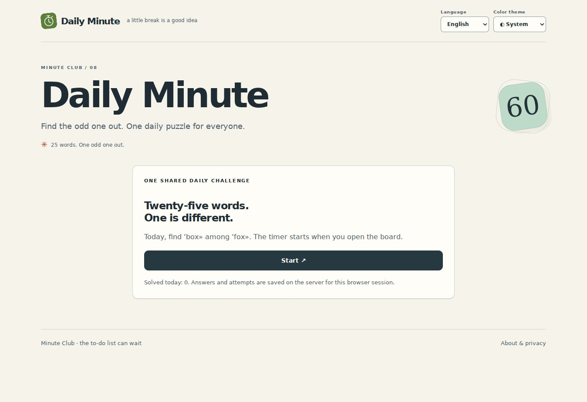

<div align="center">


# Daily Minute

**Маленькая головоломка на каждый день.**

Найди лишнее слово, проверь своё время и поделись результатом.

[English](README.md) · **Русский**

  

</div>

[Возможности](#возможности) · [Технологии](#технологии) · [Запуск](#запуск) · [Лицензия](LICENSE)



*Скриншот локального приложения с пустой тестовой базой; это не статистика аудитории.*

## Возможности

- Общее ежедневное поле 5×5
- Проверка ответов сервером и секундомер
- Обмен результатами и 60 дней локальной истории

**Попробуй: Найди лишнее → заверши → поделись.**

Документация: English / Русский. Интерфейс приложения: English, Русский; выбор языка вручную или по настройкам браузера. По умолчанию тема системная; доступны ручные светлая и тёмная. Системный режим реагирует на смену темы устройства, выбор сохраняется локально.

## Технологии

| Слой | Реализация |
| --- | --- |
| Интерфейс | HTML · CSS · JavaScript / нативные ES-модули |
| Среда выполнения | Node.js 24+ · SQLite |
| Разработка | JavaScript |
| Зависимости | Без сторонних браузерных библиотек и внешних шрифтов |

## Запуск

Нужен **Node.js 24+**. Для запуска установка пакетов и сборка не требуются.

```sh
npm start
```

Открой http://localhost:3000. В корне работает это приложение; маршруты и API остальных приложений отключены. Данные сохраняются в `data/minute.sqlite`.

## Размещение

Задай `PUBLIC_ORIGIN` как точный HTTPS-origin, выдели постоянный `DATA_DIR` и поставь перед процессом HTTPS reverse proxy. В репозитории есть примеры Dockerfile, Caddy, переменных окружения и systemd. Каждому приложению нужны собственные порт и каталог данных. `.env` не читается автоматически: экспортируй переменные или запускай `node --env-file=.env server/index.mjs`. Резервные копии, модерация, ограничения идентификации и хранение описаны в [OPERATIONS.md](OPERATIONS.md) (англ.).

## Как это устроено

Семь пар слов повторяются по кругу. Секундомер измеряет время, но не останавливает игру через минуту. Это развлечение, а не соревнование с защитой от читов.

## Проверки

Нужен Node.js 24+.

```sh
npm test
npm run check
```


---

[Другие проекты den9911](https://github.com/den9911) · [Сообщить о проблеме](https://github.com/den9911/daily-minute/issues) · [LICENSE](LICENSE)
